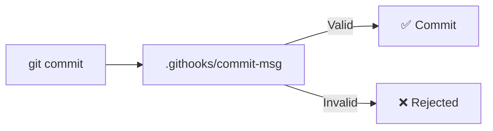

# No more messy commit logs, starting from a simple git hook

*Devlog: 2026-07*

Clean commit logs shouldn't require heavy dependencies.

Late July I opened [PR #965](https://github.com/g3w-suite/g3w-client/pull/965) to enforce **Conventional Commits** across the team using a native, zero-dependency Git hook workflow:

If you're not familiar with it, [Conventional Commits](https://conventionalcommits.org) is a lightweight convention on top of commit messages. Instead of vague logs like `"fix stuff"` or `"wip"`, every commit follows a structured pattern:

```text
<type>(optional scope): <description>

feat(map): add elevation profile toggle
fix(editing): prevent duplicate feature creation
chore(githooks): enforce conventional commits
```

Keeping messages consistent makes the git history readable at a glance and unlocks automated changelogs and semantic versioning down the line.

To avoid relying on heavy third-party tools like Husky, I wired everything directly into native git: running `npm install` triggers a `prepare` script that sets `core.hooksPath` to `.githooks`, where a lightweight `commit-msg` script validates each message against a regex before git records it.



No extra npm bloat—just plain git doing what it already knows how to do.

Meanwhile, I pushed a couple of updates to [leaflet-elevation](https://github.com/Raruto/leaflet-elevation).

On the review side in [g3w-admin](https://github.com/g3w-suite/g3w-admin), I dug into two substantial changes:

- **[PR #1348](https://github.com/g3w-suite/g3w-admin/pull/1348)**: A major stack bump moving from Django 4.2 to 5.2, Python 3.14, and Qt6 (alongside replacing `django-bleach` with `django-nh3`).
- **[PR #1435](https://github.com/g3w-suite/g3w-admin/pull/1435)**: Server-side pagination for alphanumeric layers in the editing table, preventing browser freezes when loading thousands of features at once.