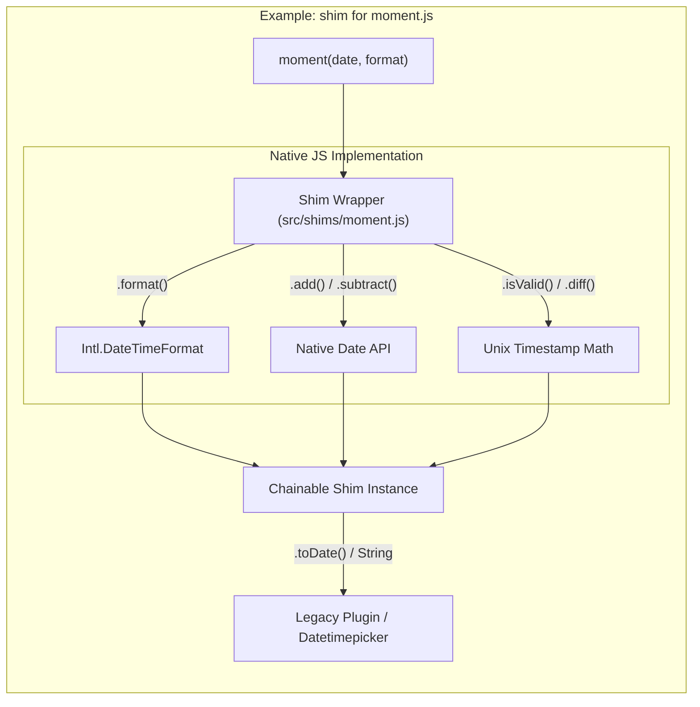

# Shims to the rescue: dropping jQuery & friends

*Devlog: 2026-09*

Legacy codebases don't die from one big bug. They die from a thousand tiny dependencies.

For years, [g3w-client](https://github.com/g3w-suite/g3w-client) dragged around heavy libraries from another era: jQuery, moment.js, Select2 and so on.

In PR [#981](https://github.com/g3w-suite/g3w-client/pull/981), we went on a massive diet, without a risky full rewrite.

To mimic old APIs we introduced lightweight internal **shims** (`src/shims/jquery.js`, `src/shims/moment.js`, `src/shims/select2.js`) and keep plugins running while stripping out the heavy libraries underneath.

We also axed 8 more packages (including `jszip`, `shpjs`, and `lodash.clonedeep`) and unified 8 scattered form mixins into one clean `<g3w-field>` component.

This month I also reviewed some other pull requests proposing to remove `layersstore` across [the client](https://github.com/g3w-suite/g3w-client/pull/963) and [the admin](https://github.com/g3w-suite/g3w-admin/pull/1423), centralizing layer and TOC state directly under `ApplicationState.project`.

I also looked at editing-related changes, like the [Add/Remove Hole in Polygon tool](https://github.com/g3w-suite/g3w-admin/pull/1456) and [showing all vertices in MultiGeometry features](https://github.com/g3w-suite/g3w-admin/pull/1470).

On the authoring side, I opened a few pull requests on g3w-client: a [release workflow](https://github.com/g3w-suite/g3w-client/pull/978), a [fix for sidebar positioning inside an iframe](https://github.com/g3w-suite/g3w-client/pull/976), [updated instructions for building a minimal plugin](https://github.com/g3w-suite/g3w-client/pull/977), and a [finer ordering control for context menu items](https://github.com/g3w-suite/g3w-client/pull/970). I also pushed commits to g3w-admin, g3w-client, the editing plugin, and g3w-admin-panoramax.

The month closed with two new issues: finding [adding g3w-admin v4.0 support](https://github.com/g3w-suite/g3w-admin-ps-timeseries/issues/12) to the timeseries plugin. Elsewhere, I reviewed a [marker height fix](https://github.com/Raruto/leaflet-elevation/pull/310) in leaflet-elevation and committed to that repo and to my own site.
