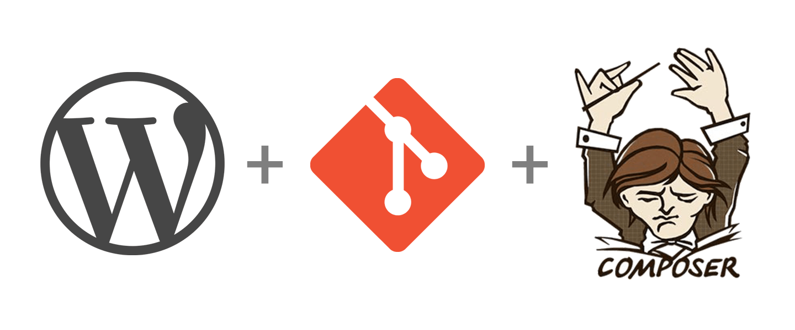

# WordPress Git Work and Pull Requests Across Neighboring Plugins

*Devlog: 2018-04*

In April I authored commits in [Raruto/wordpress-git](https://github.com/Raruto/wordpress-git) and [Raruto/IlMagnifico](https://github.com/Raruto/IlMagnifico).

*A current illustration of wordpress-git.*

Alongside that, I reached out to a few neighboring WordPress projects. I opened an issue on [cedaro/satispress](https://github.com/cedaro/satispress/issues/29) about the package.json, the satispress\_packages\_json transient, and a SatisPress Repository URL not being found. In [tomjn/composerpress](https://github.com/tomjn/composerpress) I authored commits and opened two pull requests: [one enhancing the readme and fallback package naming, and adding a custom fallback namespace and click-to-download](https://github.com/tomjn/composerpress/pull/9), and [a smaller one fixing a T\_PAAMAYIM\_NEKUDOTAYIM error](https://github.com/tomjn/composerpress/pull/10).

I also opened two pull requests on [afragen/git-updater](https://github.com/afragen/git-updater): [one adding Rest Process logging](https://github.com/afragen/git-updater/pull/666) and [another with hook logging and UI improvement suggestions](https://github.com/afragen/git-updater/pull/668).
