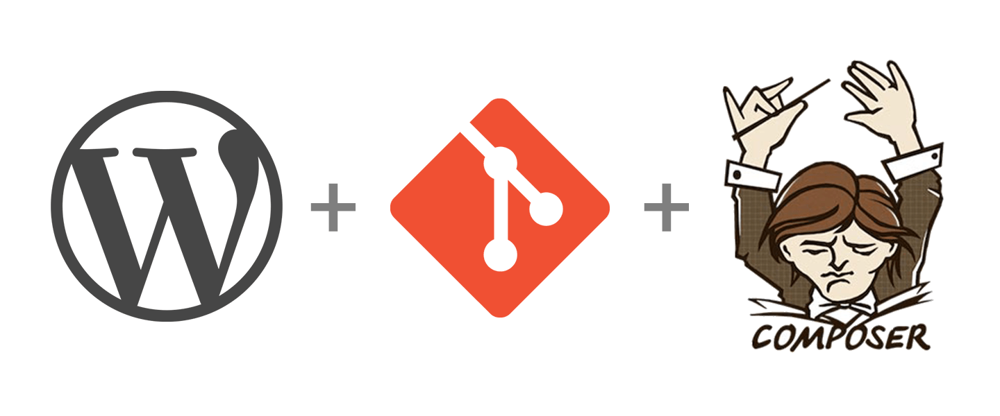

# Continued Commits to wordpress-git

*Devlog: 2018-07*

In July, I contributed commits to [Raruto/wordpress-git](https://github.com/Raruto/wordpress-git).

*A current illustration of wordpress-git.*