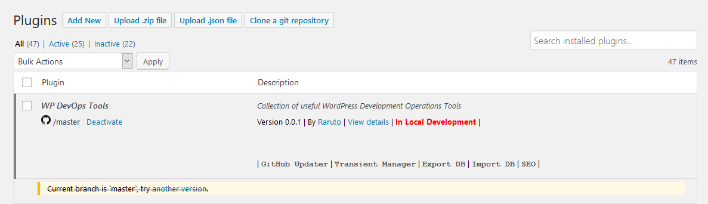

# DevOps Commits and Git Updater Hook Issues

*Devlog: 2018-12*

In December I authored commits in [Raruto/wp-devops](https://github.com/Raruto/wp-devops), [Raruto/wordpress-git](https://github.com/Raruto/wordpress-git) and [Raruto/raruto.github.io](https://github.com/Raruto/raruto.github.io).

*A current illustration of wp-devops.*

Along the way, I opened two issues on [afragen/git-updater](https://github.com/afragen/git-updater): one about [disabling update fetching when a plugin is on wp.org](https://github.com/afragen/git-updater/issues/746), and another about a [Rest\\\_Update log\\\_exit hook](https://github.com/afragen/git-updater/issues/747).
