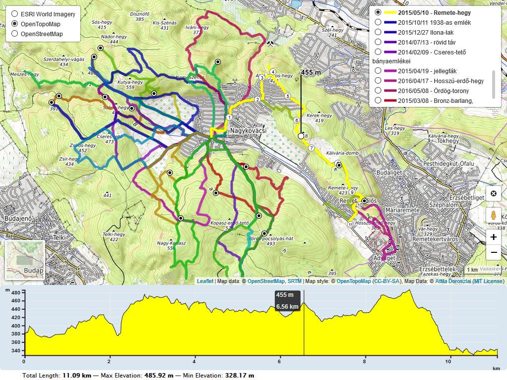

# Another Month of Leaflet Elevation Commits

*Devlog: 2020-09*

In September, I contributed commits to [Raruto/leaflet-elevation](https://github.com/Raruto/leaflet-elevation).

*A current illustration of leaflet-elevation.*