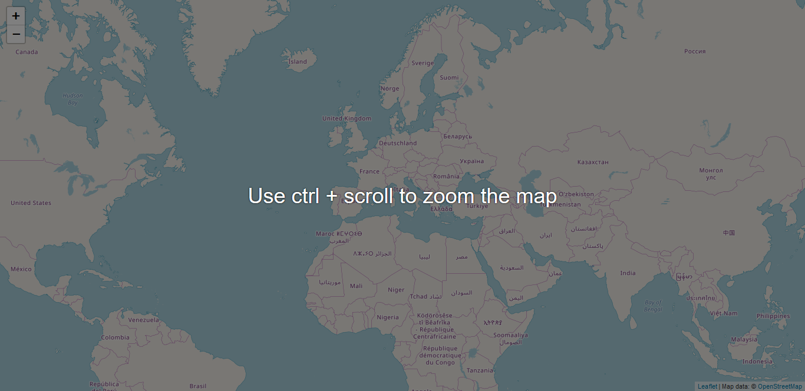

# Gesture Handling and Elevation Plugin Commits

*Devlog: 2021-06*

In June, I contributed commits to [Raruto/leaflet-gesture-handling](https://github.com/Raruto/leaflet-gesture-handling) and [Raruto/leaflet-elevation](https://github.com/Raruto/leaflet-elevation).

*A current illustration of leaflet-gesture-handling.*