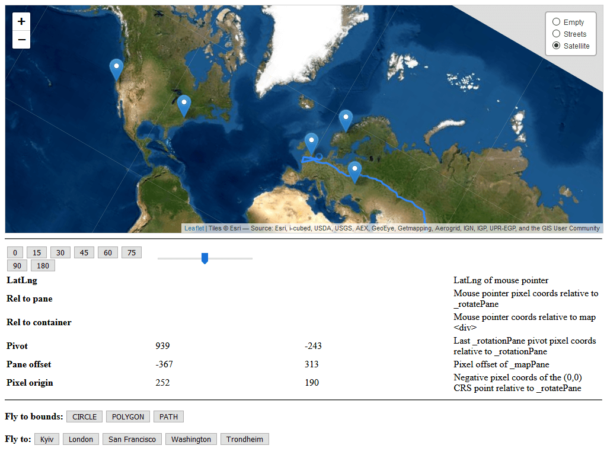

# Leaflet Rotate, UI and a Cockpit Stale Config Proposal

*Devlog: 2021-11*

In November I contributed to several Leaflet projects. Early on, I made commits to [leaflet-rotate](https://github.com/Raruto/leaflet-rotate) and [leaflet-ui](https://github.com/Raruto/leaflet-ui), and I also opened a pull request to [agentejo/cockpit](https://github.com/agentejo/cockpit/pull/1473) proposing a stale.yml file.

*A current illustration of leaflet-rotate.*

I also authored commits in [leaflet-elevation](https://github.com/Raruto/leaflet-elevation), where I authored commits on both the 3rd and the 15th, and my [GitHub Pages site](https://github.com/Raruto/raruto.github.io), where I authored a batch of commits on the 3rd and one more on the 23rd.
