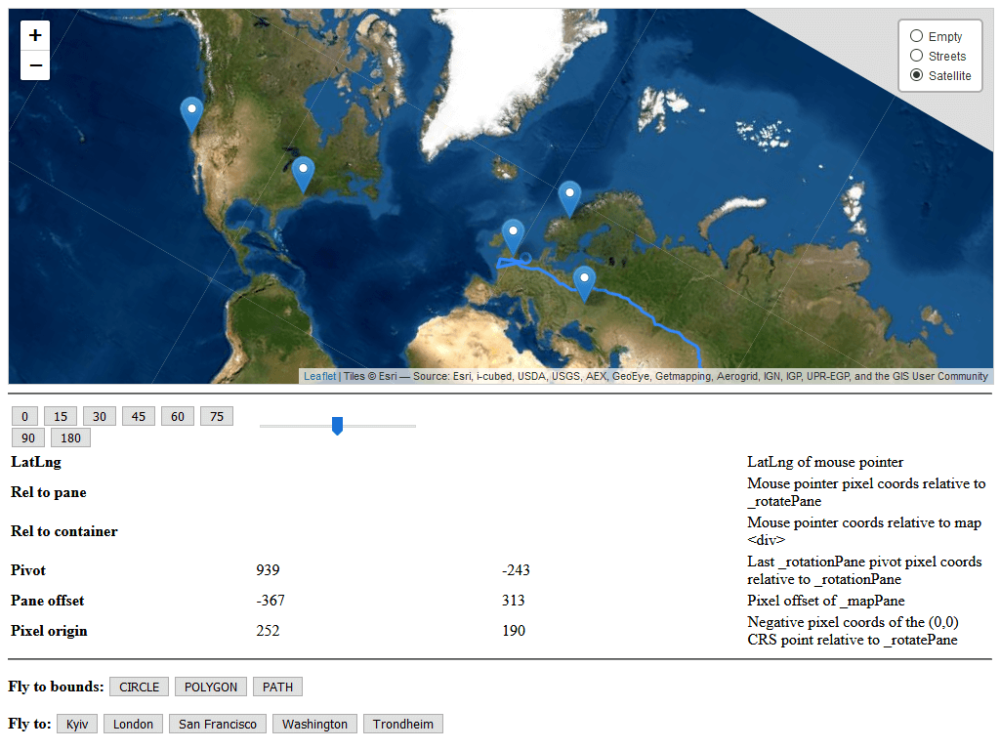

# Proposals for Vue Single-File Components

*Devlog: 2023-02*

In February I contributed to [g3w-client](https://github.com/g3w-suite/g3w-client). I opened a batch of pull requests to move older components into Vue single-file components, including [GlobalProgressBar](https://github.com/g3w-suite/g3w-client/pull/332) and [GlobalBarLoader](https://github.com/g3w-suite/g3w-client/pull/331). I also opened pull requests for [new app entrypoints](https://github.com/g3w-suite/g3w-client/pull/325), a [queryresultsservice refactor](https://github.com/g3w-suite/g3w-client/pull/317), and a [rotating Street View pegman marker](https://github.com/g3w-suite/g3w-client/pull/344).

I opened several issues along the way, covering a [Street View marker angle mismatch](https://github.com/g3w-suite/g3w-client/issues/337), [small-screen menu problems](https://github.com/g3w-suite/g3w-client/issues/358), and an [X2JS upgrade](https://github.com/g3w-suite/g3w-client/issues/360). I also reviewed pull requests on g3w-client and [g3w-admin](https://github.com/g3w-suite/g3w-admin/pull/456), including work on [Spatial Bookmarks](https://github.com/g3w-suite/g3w-client/pull/322) and a [top menu clipping fix](https://github.com/g3w-suite/g3w-client/pull/359).

Outside g3w-client, I authored commits in [leaflet-rotate](https://github.com/Raruto/leaflet-rotate) and [leaflet-gesture-handling](https://github.com/Raruto/leaflet-gesture-handling). I also opened a [pull request](https://github.com/Raruto/leaflet-rotate/pull/24) on leaflet-rotate about \`this.\_map\` being undefined after removing the rotate control, and a [README pull request](https://github.com/g3w-suite/g3w-client-plugin-editing/pull/14) for the editing plugin.

*A current illustration of leaflet-rotate.*