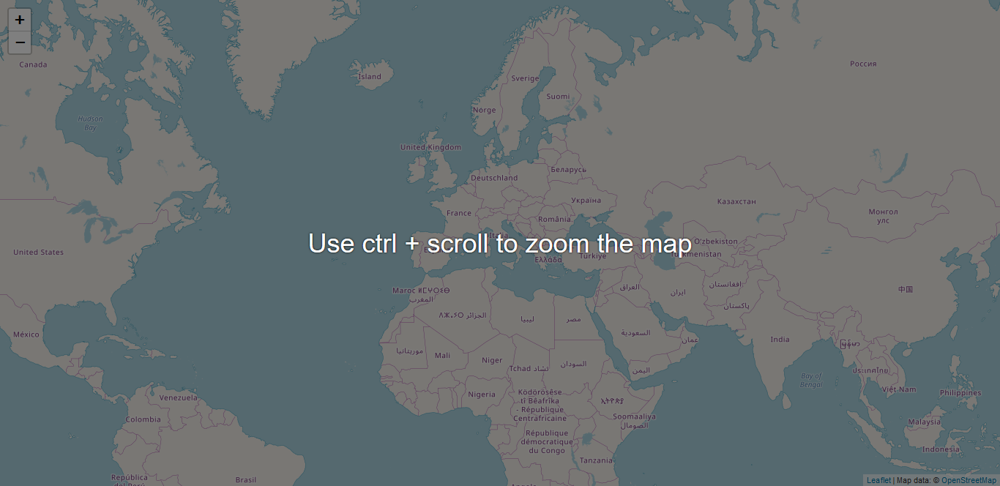

# Small-Screen Issues and Polyfill Removal in g3w-client

*Devlog: 2023-03*

In March I contributed to [g3w-client](https://github.com/g3w-suite/g3w-client). I opened issues on small-screen behavior, like the [right sidebar panel not always being visible](https://github.com/g3w-suite/g3w-client/issues/371), and a [tooltip getting cropped](https://github.com/g3w-suite/g3w-client/issues/362). I also opened a pull request to [remove the regenerator-runtime polyfill](https://github.com/g3w-suite/g3w-client/pull/365) and reviewed several others, including the [zoomhistory map control](https://github.com/g3w-suite/g3w-client/pull/388) and [multi-layer search](https://github.com/g3w-suite/g3w-client/pull/376).

On the admin side, I opened issues in [g3w-admin](https://github.com/g3w-suite/g3w-admin), such as the [page loader stuck at 99% in Firefox](https://github.com/g3w-suite/g3w-admin/issues/507) and an [optional project logo](https://github.com/g3w-suite/g3w-admin/issues/498). I also opened a PR [documenting the default API root](https://github.com/g3w-suite/g3w-admin/pull/492) and reviewed a few others, including the [CI update to Ubuntu Jammy and QGIS 3.28](https://github.com/g3w-suite/g3w-admin/pull/483).

I also authored commits in [g3w-admin-portal](https://github.com/g3w-suite/g3w-admin-portal), [g3w-suite-demo-projects](https://github.com/g3w-suite/g3w-suite-demo-projects), [makefiles](https://github.com/g3w-suite/makefiles) (where I opened an [issue about upgrading setuptools](https://github.com/g3w-suite/makefiles/issues/1)), and [leaflet-gesture-handling](https://github.com/Raruto/leaflet-gesture-handling).

*A current illustration of leaflet-gesture-handling.*