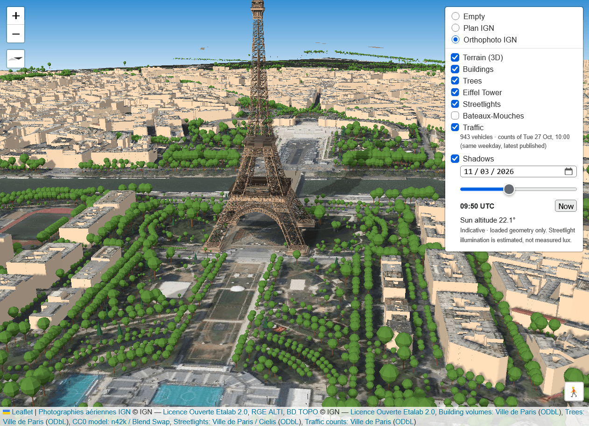

# Introducing City Mapper and Revisiting Leaflet Plugins

*Devlog: 2026-11*

November began with a new project: I made [leaflet-city-mapper](https://github.com/Raruto/leaflet-city-mapper) public on the 3rd, with 52 commits authored that day. I published v0.0.1 right away and kept iterating, ending up at [v0.0.8](https://github.com/Raruto/leaflet-city-mapper/releases/tag/v0.0.8) a week later. Along the way I starred a few WebGPU and Rust-to-WASM projects, such as [wgpu](https://github.com/gfx-rs/wgpu) and [wasm-bindgen](https://github.com/wasm-bindgen/wasm-bindgen).

*A current illustration of leaflet-city-mapper.*

In parallel I worked on [leaflet-rotate](https://github.com/Raruto/leaflet-rotate): a fix for maxBounds handling, a fix for [panInside after resetting bearing to 0](https://github.com/Raruto/leaflet-rotate/pull/77), and a [pull request adding support for Leaflet v2.0.0-beta.3](https://github.com/Raruto/leaflet-rotate/pull/78). I also published v0.5.3 and v0.5.4, and closed an [issue about marker interactions](https://github.com/Raruto/leaflet-rotate/issues/76).

From the 11th to the 14th I went through many of my other Leaflet plugins, including elevation, pegman, pointable, kmz and trails, and shipped pointable [v0.2.0](https://github.com/Raruto/leaflet-pointable/releases/tag/v0.2.0) and [v0.2.1](https://github.com/Raruto/leaflet-pointable/releases/tag/v0.2.1). I closed a [locale-dependent number formatting issue](https://github.com/Raruto/leaflet-elevation/issues/319) in leaflet-elevation. I also reviewed two [g3w-client](https://github.com/g3w-suite/g3w-client/pull/1009) pull requests. On the 14th I opened a [pull request to add a bunch of my plugins](https://github.com/Leaflet/Leaflet/pull/10593) to the Leaflet plugin list, and a [discussion about bringing a WebGPU 3D engine to Leaflet](https://github.com/Leaflet/Leaflet/discussions/10592).
